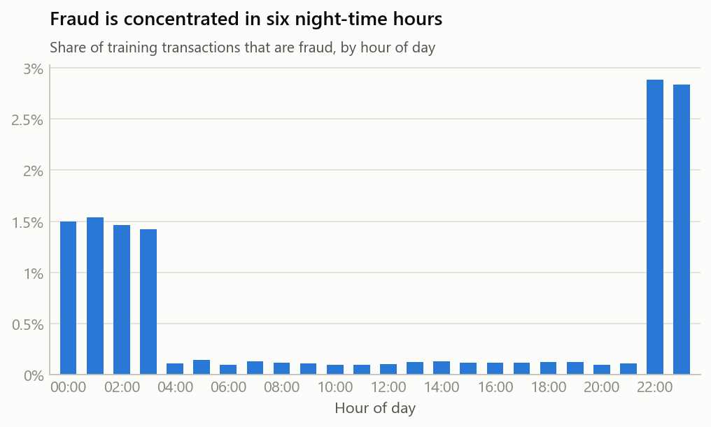
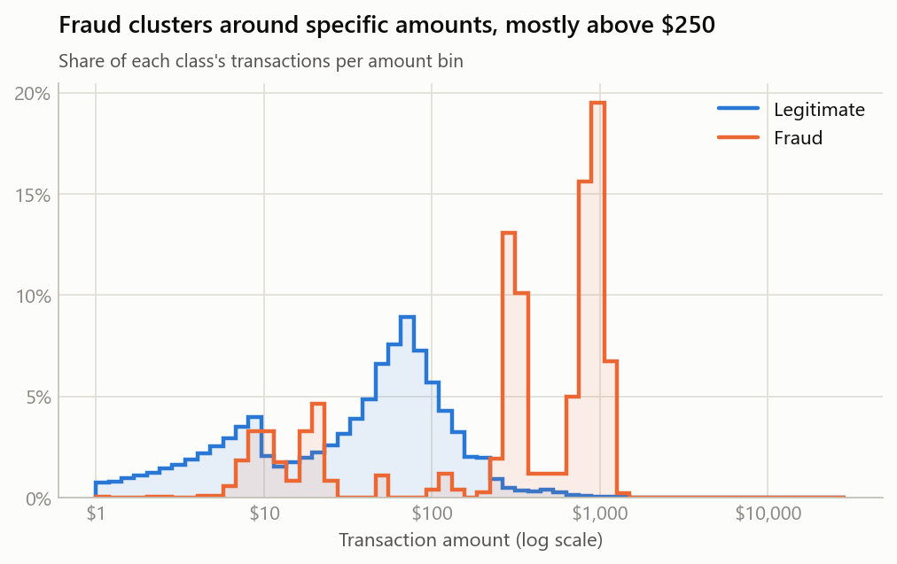
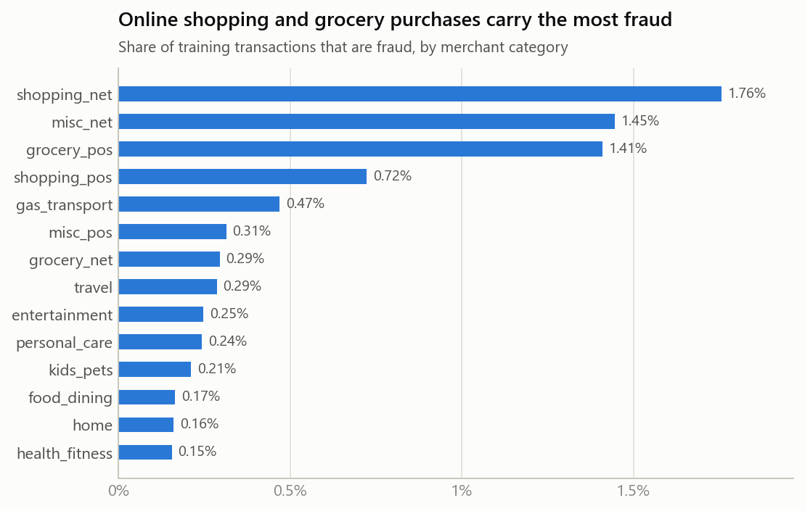
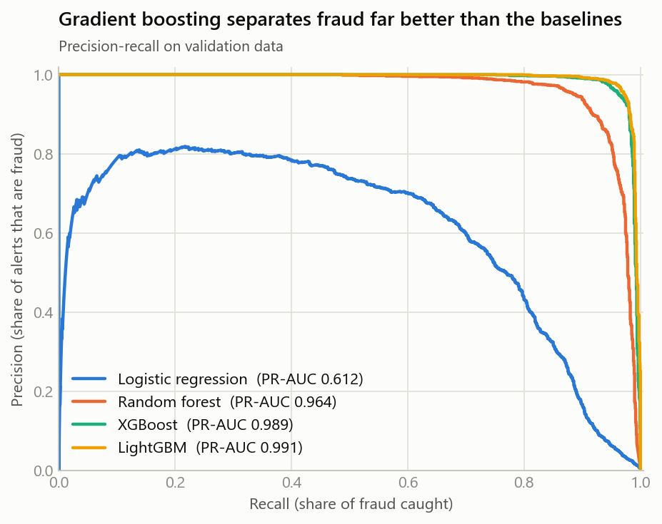
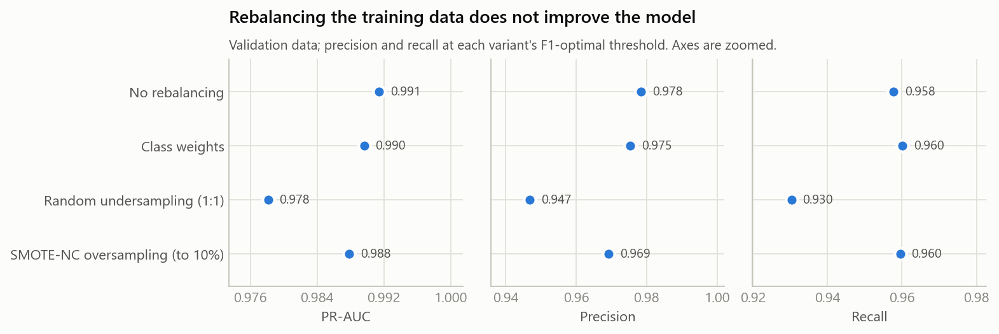
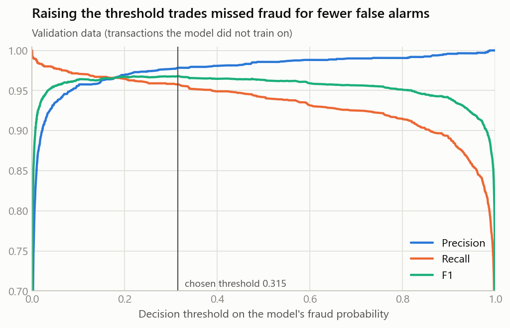
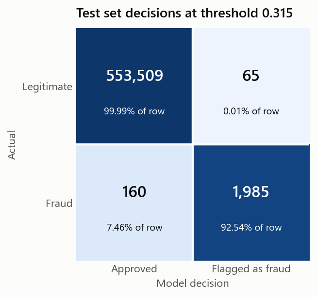
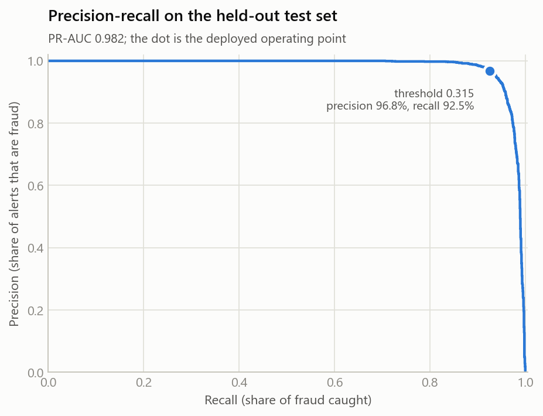
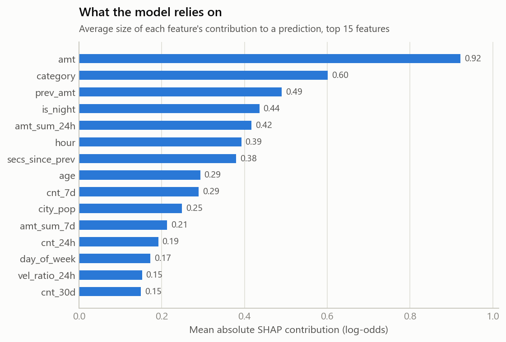

# Credit Card Fraud Detection

**Assignment 1 — Machine Learning.** A system that scores every card transaction for fraud at the moment it is processed. It learns from 1.3 million historical transactions in which only 0.58% are fraudulent, and it is evaluated on 556 thousand later transactions it never saw during development.

## Result

Scored once on the held-out test file (555,719 transactions from the six months after the training period, 2,145 of them fraud), using a decision threshold fixed beforehand:

| Measure | Test set |
|---|---|
| Fraud caught (recall) | **92.5%** — 1,985 of 2,145 |
| Alerts that were real fraud (precision) | **96.8%** — 1,985 of 2,050 |
| Legitimate transactions wrongly flagged | **65 of 553,574** — about 1 in 8,500 |
| Fraud value caught | 96.1% of $1.13 million |
| F1 / PR-AUC / ROC-AUC | 0.946 / 0.982 / 0.9996 |
| Real-time scoring latency | about 0.5 ms per transaction (median) |

The model is LightGBM on 24 features, most of which describe how a transaction compares with the same card's own past behaviour.

How the assignment's requirements map to this document:

| Requirement | Where |
|---|---|
| Identify suspicious transaction patterns | [§2](#2-suspicious-patterns-in-the-data), [§3](#3-features) |
| Handle imbalanced data | [§6](#6-handling-class-imbalance) |
| Build a reliable classification model | [§4](#4-how-models-were-judged), [§5](#5-choosing-the-model), [§8](#8-final-results-on-the-test-set) |
| Minimise false positives and false negatives | [§7](#7-balancing-false-positives-and-false-negatives) |
| Work in real time, during transaction processing | [§9](#9-real-time-scoring) |

## 1. Data

| File | Period | Transactions | Frauds | Fraud rate |
|---|---|---|---|---|
| `fraudTrain.csv` | 1 Jan 2019 – 21 Jun 2020 | 1,296,675 | 7,506 | 0.58% |
| `fraudTest.csv` | 21 Jun 2020 – 31 Dec 2020 | 555,719 | 2,145 | 0.39% |

Each row is one transaction: time, card number, merchant and category, amount, cardholder details (name, address, date of birth, job, home coordinates), merchant coordinates and the fraud label. There are 983 cards in the training file and no missing values or duplicate transaction IDs.

The files match the public simulated ("Sparkov") credit card dataset, so the patterns are cleaner than real fraud would be. See [Limitations](#10-limitations).

**A data quirk that matters.** The readable `trans_date_trans_time` column is not a consistent timeline: it repeats 28 Feb 2019 and skips 29 Feb 2020, so intervals and weekdays taken from it are wrong by a day for part of the data. The `unix_time` column is continuous. Everything time-related here (ordering, time gaps, hour, weekday) uses `unix_time`.

## 2. Suspicious patterns in the data

Three patterns stand out before any modelling.

**Time of day.** Between 22:00 and 03:59 the fraud rate is 1.4–2.9%, against roughly 0.1% for the rest of the day.



**Amount.** Three quarters of fraudulent transactions are above $250; only 2.6% of legitimate ones are. The median fraud is $397, the median legitimate purchase $47.



**Merchant category.** Online shopping, miscellaneous online and in-store grocery have fraud rates around ten times those of the safest categories.



**Bursts.** Fraud arrives in runs on a compromised card. Of the 983 cards, 762 were hit during the training period, each in a single episode of about ten fraudulent transactions spread over two days, typically an hour apart. This is why the card's recent activity is so informative, and it is what the behaviour features in the next section capture.

## 3. Features

The model sees 24 features. Eight describe the transaction and cardholder; sixteen describe how the transaction compares with the same card's history.

| Group | Features | What it captures |
|---|---|---|
| The transaction | `amt`, `category`, `hour`, `day_of_week`, `is_night`, `dist_km` | Size, type and timing of the purchase; distance from the cardholder's home to the merchant |
| The cardholder | `age`, `city_pop` | Demographic profile |
| Recency | `secs_since_prev`, `prev_amt` | How long ago, and for how much, the card was last used |
| Velocity | `cnt_1h`, `cnt_24h`, `cnt_7d`, `cnt_30d`, `amt_sum_1h`, `amt_sum_24h`, `amt_sum_7d`, `vel_ratio_24h` | Bursts of activity or spending on the card |
| Deviation from the card's normal | `amt_ratio_30d`, `amt_ratio_hist`, `amt_z_hist`, `amt_ratio_max`, `cat_share_hist`, `night_share_hist` | Whether this amount, category or hour is unusual for this particular card |

The behaviour features are worth the effort: the same model with only the transaction and cardholder features scores PR-AUC 0.909 on validation; with them it scores 0.991, and missed frauds fall from 303 to 68.

Safeguards against the model learning something it could not know in production:

- **Past only.** Every behaviour feature is computed from the card's transactions strictly before the one being scored. An automated test confirms that a transaction's features are identical whether or not later transactions exist.
- **No label-derived features.** Nothing like "this card had fraud before" is used. In reality fraud is confirmed days or weeks later, so such a feature would not be available at scoring time.
- **No identifiers.** Card number, names, street, city, state, zip, job, home coordinates, merchant name and transaction ID are excluded; with under a thousand cards they would let the model memorise customers. Gender is excluded as a protected attribute.
- **Test features use history, never labels.** Test transactions carry the card's activity from the training period, exactly as a live system would.

## 4. How models were judged

**Split by time.** Fraud detection always scores transactions that come after the ones the model learned from, so the training file is split chronologically rather than at random:

| Set | Period | Transactions | Frauds | Used for |
|---|---|---|---|---|
| Fit | Jan 2019 – Feb 2020 | 1,024,843 | 5,899 | Training candidate models |
| Validation | Mar – Jun 2020 | 271,832 | 1,607 | Every choice: model, imbalance strategy, settings, threshold |
| Test | Jun – Dec 2020 | 555,719 | 2,145 | Scored once, after all choices were final |

**Metric.** Accuracy is useless here: approving everything is 99.4% accurate and catches no fraud. ROC-AUC is also misleading at this imbalance; the logistic regression below has ROC-AUC 0.984 yet a third of its alerts are wrong. The primary metric is **PR-AUC** (area under the precision-recall curve), with precision, recall and the raw counts of false alarms and missed frauds alongside.

## 5. Choosing the model

Validation results. Precision, recall and counts are at each model's own F1-optimal threshold.

| Model | PR-AUC | Precision | Recall | F1 | False alarms | Missed frauds |
|---|---|---|---|---|---|---|
| Logistic regression (class-weighted) | 0.612 | 0.671 | 0.644 | 0.657 | 507 | 572 |
| Random forest (class-weighted) | 0.964 | 0.944 | 0.899 | 0.921 | 86 | 162 |
| XGBoost | 0.989 | 0.974 | 0.947 | 0.961 | 40 | 85 |
| **LightGBM** | **0.991** | **0.978** | **0.958** | **0.968** | **34** | **68** |



Fraud here is defined by combinations (a large amount, at night, in a risky category, shortly after another large purchase), which tree ensembles represent directly and a linear model cannot. LightGBM was the best and also the fastest to train of the three tree ensembles.

A random search over seven LightGBM configurations (tree size, leaf size, row and column sampling, regularisation) found nothing better than the default settings: validation PR-AUC ranged from 0.970 to 0.991, with the default at the top. Details are in [reports/tuning.csv](reports/tuning.csv).

## 6. Handling class imbalance

There are 173 legitimate transactions for every fraud in the fit set. Four ways of dealing with that at training time were compared on the same model and the same validation data, which was never resampled and keeps the real fraud rate:

| Strategy | Training rows (frauds) | PR-AUC | Precision | Recall | False alarms | Missed frauds |
|---|---|---|---|---|---|---|
| **No rebalancing** | 1,024,843 (5,899) | **0.991** | **0.978** | 0.958 | **34** | 68 |
| Class weights (each fraud counts 173×) | 1,024,843 (5,899) | 0.990 | 0.975 | 0.960 | 39 | 64 |
| Random undersampling to 1:1 | 11,798 (5,899) | 0.978 | 0.947 | 0.930 | 84 | 112 |
| SMOTE-NC oversampling to 10% fraud | 1,120,838 (101,894) | 0.988 | 0.969 | 0.960 | 49 | 65 |



Rebalancing did not help. Class weights and SMOTE recover three or four more frauds at the cost of five to fifteen more false alarms, and rank transactions slightly worse overall. Undersampling is clearly worse: it throws away 99% of the legitimate transactions, and with them the model's picture of what normal looks like.

So the imbalance is handled in three places, none of which is resampling:

1. **Features** that separate the classes well enough for 5,899 fraud examples to be plenty.
2. **Metrics** that are not flattered by the majority class (§4).
3. **The decision threshold**, tuned on validation data instead of left at 0.5 (§7).

## 7. Balancing false positives and false negatives

The model outputs a fraud probability; the threshold decides what gets flagged. A missed fraud costs money and a false alarm blocks a genuine customer, so this is the lever that trades one against the other. On validation data:

| Threshold | Precision | Recall | F1 | False alarms | Missed frauds | Fraud value caught |
|---|---|---|---|---|---|---|
| 0.05 | 0.935 | 0.978 | 0.956 | 109 | 36 | 99.3% |
| 0.10 | 0.956 | 0.971 | 0.963 | 72 | 47 | 99.0% |
| 0.20 | 0.970 | 0.965 | 0.967 | 48 | 57 | 98.5% |
| **0.315** | **0.978** | **0.958** | **0.968** | **34** | **68** | **98.1%** |
| 0.50 | 0.986 | 0.942 | 0.963 | 22 | 94 | 97.0% |
| 0.70 | 0.990 | 0.925 | 0.956 | 15 | 121 | 96.1% |
| 0.90 | 0.996 | 0.890 | 0.940 | 6 | 177 | 93.1% |



The deployed threshold is **0.315**, the point that maximises F1, which weighs both kinds of error equally as the assignment asks. F1 is nearly flat between 0.2 and 0.5, so the choice within that range is a business decision rather than a statistical one: a bank that prefers to inconvenience fewer customers can move to 0.5 and lose about 1.6 points of recall; one that prefers to stop more fraud can move to 0.1. The threshold is a single number in the saved model bundle.

## 8. Final results on the test set

After every choice above was fixed, the model was refit on the whole training file and the test file was scored once.



| | Validation | Test |
|---|---|---|
| PR-AUC | 0.991 | 0.982 |
| ROC-AUC | 0.9999 | 0.9996 |
| Precision | 97.8% | 96.8% |
| Recall | 95.8% | 92.5% |
| F1 | 0.968 | 0.946 |
| False-alarm rate on legitimate transactions | 0.013% | 0.012% |
| Fraud value caught | 98.1% | 96.1% |



**Test performance is lower than validation, mainly in recall** (92.5% against 95.8%). The validation numbers are slightly optimistic because the threshold and settings were chosen on that data, and the test period extends six months beyond anything the model or its settings ever saw. The false-alarm rate held steady. By value the model does better than by count, 96.1% of fraud dollars against 92.5% of fraud transactions, because the frauds it misses skew small.

By month, recall moves between 0.90 and 0.95 without a steady downward trend. December is the weakest month, when transaction volume doubles:

| Month (2020) | Transactions | Frauds | Precision | Recall | False alarms | Missed frauds |
|---|---|---|---|---|---|---|
| Jun (from 21st) | 30,058 | 133 | 1.000 | 0.955 | 0 | 6 |
| Jul | 85,848 | 321 | 0.967 | 0.913 | 10 | 28 |
| Aug | 88,759 | 415 | 0.977 | 0.928 | 9 | 30 |
| Sep | 69,533 | 340 | 0.957 | 0.926 | 14 | 25 |
| Oct | 69,348 | 384 | 0.967 | 0.927 | 12 | 28 |
| Nov | 72,635 | 294 | 0.955 | 0.946 | 13 | 16 |
| Dec | 139,538 | 258 | 0.971 | 0.895 | 7 | 27 |

**Does it work on customers it has never seen?** With under a thousand cards, a model could score well by remembering which customers were defrauded. To check, a fifth of the cards were withheld from training entirely and the model was scored separately on them:

| Validation cards | Cards | Frauds | PR-AUC | Precision | Recall |
|---|---|---|---|---|---|
| Seen in training | 739 | 1,248 | 0.990 | 0.984 | 0.950 |
| Never seen | 188 | 359 | 0.992 | 0.980 | 0.958 |

Performance is the same on unseen cards, so the model has learned what fraud looks like rather than who was defrauded.

**What the model relies on.** Amount, merchant category, the previous transaction's amount, night-time, and spending in the previous 24 hours carry the most weight, consistent with the patterns in §2.



## 9. Real-time scoring

`fraud/realtime.py` scores one transaction at a time, the way an authorisation system would call it.

```
incoming transaction
        │
        ▼
  card's stored state ──► 24 features ──► LightGBM ──► probability ≥ 0.315 ?
  (last 30 days of                                         │
   transactions plus                              approve, or flag with reasons
   running totals)                                         │
        ▲                                                  │
        └────────────── add this transaction ◄─────────────┘
```

Each card's state is small and fixed in shape: its transactions from the last 30 days plus running totals (count, sum, sum of squares, maximum, night-time count, count per category). Scoring never touches the historical dataset. In this project the state is held in memory; in production the same fields would live in a low-latency key-value store keyed by card number.

Measured by `realtime_demo.py`, which warms up card state from the training period and then streams the first 20,000 test transactions one by one on a laptop, single-threaded:

| | |
|---|---|
| Warm-up from 1.3 million historical transactions | 3 seconds |
| Latency per transaction (features + model + state update) | median 0.4–0.6 ms, 99th percentile 0.9–2.4 ms across two runs |
| Throughput | 1,200–2,100 transactions per second on one core |
| Agreement with the batch pipeline used for training | identical: 0 of 20,000 decisions differ, largest probability difference 0 |

The last row matters most. A common way for fraud models to fail in production is that the live system computes features slightly differently from the training code. Here the two implementations are checked against each other, both in the demo and in the automated tests.

Every flagged transaction comes with the top reasons, taken from the model's own per-prediction SHAP contributions:

```
2020-06-21 22:37:27  card ...0820  $  620.33  entertainment  P(fraud)=1.000  actual: FRAUD
    - amount $620.33
    - $1,813.83 spent on the card in the previous 24 h
    - $780.52 spent on the card in the previous hour
```

## 10. Limitations

- **Simulated data.** The dataset is generated, and its fraud follows a few crisp rules. Real fraud is messier and adapts to defences; expect lower numbers on real transactions.
- **Performance after deployment is lower than during development.** Recall fell from 95.8% on validation to 92.5% on test. A live system needs monitoring of precision and recall as labels arrive, and periodic retraining.
- **The threshold assumes both errors matter equally.** F1 is a stand-in for a real cost model. With actual costs of a missed fraud and of a blocked customer, the threshold should be set to minimise expected cost using the table in §7.
- **Labels are assumed correct and complete.** In practice fraud is confirmed with a delay and some is never reported, so recent training data is partly mislabelled.
- **Card state is in memory and assumes transactions arrive in time order.** A production deployment needs a shared, durable store and a rule for late-arriving events.
- **Age and city population are used as features.** They help (the profile of fraud differs by demographic in this data) and the unseen-card check shows they are not acting as customer identifiers, but whether cardholder demographics may be used is a policy question for the institution.

## Running it

```bash
pip install -r requirements.txt

# Train, compare, select and evaluate. Writes models/ and reports/.
python train.py --train path/to/fraudTrain.csv --test path/to/fraudTest.csv

# Stream test transactions through the real-time scorer.
python realtime_demo.py --n 20000

# Feature-pipeline tests (synthetic data, no CSVs needed).
python -m pytest tests
```

Without `--train` / `--test`, the scripts look for the two CSVs in the user's `Downloads` folder. Training is seeded, and repeated runs on the same machine reproduced the numbers above exactly. Expect 15 to 60 minutes for `train.py` depending on the machine; most of that is the comparison experiments, not the final model.

## Project layout

```
fraud/
  config.py        feature list, look-back windows, validation split date, paths
  features.py      batch feature engineering
  modeling.py      models, class-imbalance strategies, metrics
  experiments.py   model comparison, imbalance comparison, tuning, robustness checks
  realtime.py      one-transaction-at-a-time scorer with per-card state
  plots.py         figures
train.py           end-to-end pipeline
realtime_demo.py   streaming demo, latency and batch-parity check
tests/             feature tests: past-only, label-free, real-time matches batch
models/            fraud_model.joblib (model, feature list, categories, threshold)
reports/           metrics.json, result tables (CSV), figures
```
